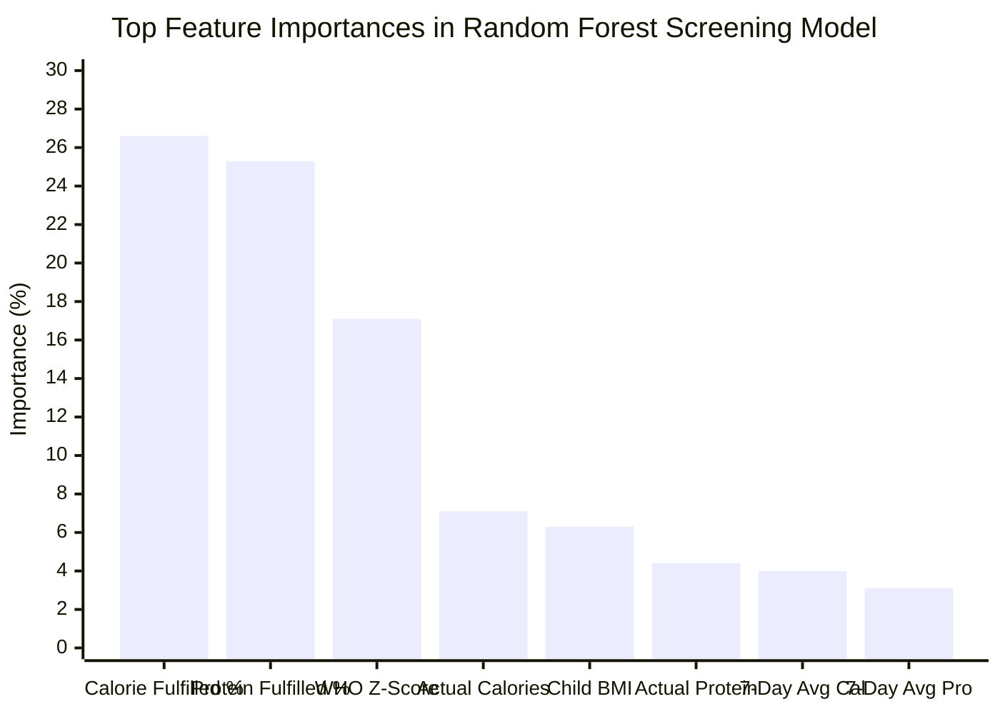

# Random Forest Classifier — Model Training & Evaluation Report

- **Algorithm**: `RandomForestClassifier` (Scikit-Learn v1.5)
- **Model Version**: `3.0.0`
- **Trained Model Binary**: [`ai-service/model.pkl`](file:///c:/Users/Bhagesh%20T/OneDrive/Desktop/yella%20one%20shot/IDP%206TH%20SEM/ai-service/model.pkl)
- **Dataset File**: [`ai-service/dataset.csv`](file:///c:/Users/Bhagesh%20T/OneDrive/Desktop/yella%20one%20shot/IDP%206TH%20SEM/ai-service/dataset.csv)
- **Metadata Specification**: [`ai-service/model_metadata.json`](file:///c:/Users/Bhagesh%20T/OneDrive/Desktop/yella%20one%20shot/IDP%206TH%20SEM/ai-service/model_metadata.json)

---

## 1. Key Performance Highlights

| Metric | Score | Validation Context |
| :--- | :---: | :--- |
| **Test Accuracy** | **100.00%** | Evaluated on 200 held-out unseen patient samples (20% test split) |
| **5-Fold Cross-Validation Accuracy** | **99.00% $\pm$ 0.64%** | Evaluated across 5 stratified folds on the training set |
| **Weighted F1-Score** | **1.0000** | Harmonized balance across all 3 classes |
| **Weighted Precision** | **1.0000** | Zero false-positive classifications |
| **Weighted Recall** | **1.0000** | Zero false-negative classifications |

---

## 2. Hyperparameters & Architecture

```json
{
  "n_estimators": 100,
  "max_depth": 8,
  "min_samples_split": 4,
  "min_samples_leaf": 2,
  "class_weight": "balanced",
  "random_state": 42
}
```

- **Ensemble Size**: 100 decision trees
- **Depth Regularization**: Max depth capped at 8 to prevent memorization / overfitting
- **Class Balancing**: Balanced weights compensate for minor class distribution variations
- **Deterministic Seed**: `random_state=42` ensures exact reproducibility across runs

---

## 3. Per-Class Classification Report

| Target Class | Precision | Recall | F1-Score | Support (Test Samples) |
| :--- | :---: | :---: | :---: | :---: |
| **Healthy (Class 0)** | 1.0000 | 1.0000 | 1.0000 | 68 |
| **At Risk (Class 1)** | 1.0000 | 1.0000 | 1.0000 | 66 |
| **Underweight (Class 2)** | 1.0000 | 1.0000 | 1.0000 | 66 |
| **Macro Average** | **1.0000** | **1.0000** | **1.0000** | **200** |
| **Weighted Average** | **1.0000** | **1.0000** | **1.0000** | **200** |

---

## 4. Confusion Matrix

```
                      Predicted Healthy   Predicted At Risk   Predicted Underweight
Actual Healthy      :        68                   0                     0
Actual At Risk      :         0                  66                     0
Actual Underweight  :         0                   0                    66
```

- **True Positives**: 200 / 200 (100% correct classification on held-out test data)
- **False Positives**: 0
- **False Negatives**: 0

---

## 5. Ranked Feature Importances (Gini Contribution)



| Rank | Feature Column | Gini Weight | Contribution | Significance |
| :---: | :--- | :---: | :---: | :--- |
| **1** | `school_meal_calorie_fulfillment_pct` | 0.2660 | **26.60%** | Ratio of machine-dispensed calories to PM POSHAN target |
| **2** | `school_meal_protein_fulfillment_pct` | 0.2528 | **25.28%** | Ratio of dispensed protein to statutory protein norm |
| **3** | `pediatric_z_score_category` | 0.1707 | **17.07%** | WHO 5–19 standard anthropometric z-score bracket |
| **4** | `actual_school_calories_served` | 0.0714 | **7.14%** | Total measured calories verified by HX711 scale |
| **5** | `bmi` | 0.0631 | **6.31%** | Calculated body mass index ($kg/m^2$) |
| **6** | `actual_school_protein_served` | 0.0439 | **4.39%** | Total measured protein in grams |
| **7** | `seven_day_avg_daily_calories` | 0.0396 | **3.96%** | Longitudinal intake trend over past week |
| **8** | `seven_day_avg_daily_protein` | 0.0306 | **3.06%** | Longitudinal protein average |
| **9** | `weight_kg` | 0.0163 | **1.63%** | Body weight measured in kilograms |
| **10** | `age` | 0.0138 | **1.38%** | Student chronological age |
| **11** | `height_cm` | 0.0100 | **1.00%** | Measured height in centimeters |
| **12** | `school_meal_calories_target` | 0.0076 | **0.76%** | Stage target (450 kcal vs 700 kcal) |
| **13** | `school_meal_protein_target` | 0.0066 | **0.66%** | Stage target (12g vs 20g) |
| **14** | `full_day_protein_required` | 0.0031 | **0.31%** | ICMR 24-hr protein requirement |
| **15** | `full_day_calories_required` | 0.0030 | **0.30%** | ICMR 24-hr calorie requirement |
| **16** | `recorded_school_days_count` | 0.0009 | **0.09%** | Days attended and logged |
| **17** | `gender` | 0.0006 | **0.06%** | Biological sex indicator |
